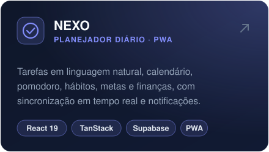
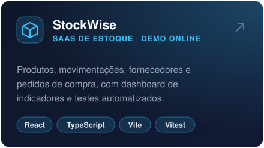
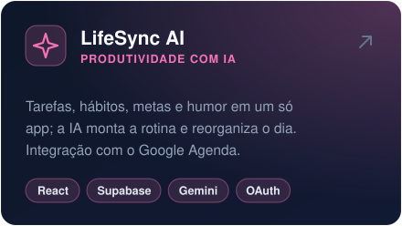

<a href="https://www.linkedin.com/in/victor-s-anjos">
  
</a>

<p align="center">
  <a href="https://www.linkedin.com/in/victor-s-anjos"></a>
  <a href="mailto:victor.vitinho1011@gmail.com"></a>
  
  
</p>

## 👋 Sobre mim

Sou estudante de **Análise e Desenvolvimento de Sistemas** na UNICID e desenvolvedor full-stack autodidata. Trabalho na administração do Condomínio Europa, e foi lá que construí meu primeiro sistema usado de verdade: uma plataforma de gestão de manutenções que organiza o dia a dia da equipe.

```ts
const victor = {
  local: "São Paulo, SP",
  formacao: "Análise e Desenvolvimento de Sistemas · UNICID (em andamento)",
  foco: ["React", "TypeScript", "Supabase", "IA aplicada a produtos"],
  aprendendo: ["arquitetura de aplicações", "testes automatizados", "modelagem de dados"],
  procurando: "estágio em desenvolvimento",
  idiomas: { portugues: "nativo", espanhol: "básico" },
};
```

## 🛠️ Stack

<p>
  
  <br/>
  
</p>

**Também uso:** TanStack Start · TanStack Router · TanStack Query · shadcn/ui · Recharts · Vitest · Row Level Security · engenharia de prompt

## 🚀 Projetos em destaque

<p align="center">
  <a href="https://github.com/Victin7/europa-manutencao"></a>
  <a href="https://github.com/Victin7/NEXO"></a>
  <a href="https://victin7.github.io/Stockwise/"></a>
  <a href="https://github.com/Victin7/LIFESYNC-AI"></a>
</p>

<details>
<summary><strong>📂 Outros projetos e estudos</strong></summary>
<br/>

| Projeto | Descrição |
|---|---|
| 🍽️ **[Palazio del Chef](https://github.com/Victin7/modelagem-dados)** | Projeto em grupo de Modelagem de Banco de Dados: requisitos, DER e dicionário de dados de um restaurante real |
| 💰 **[Finanças Pro](https://github.com/Victin7/controle-gastos)** | Controle financeiro mensal com gráficos, metas e exportação para Excel |
| 🏋️ **[EvolveFit](https://github.com/Victin7/treino)** | Organizador de treinos com IMC, plano alimentar e histórico de evolução |
| ⚡ **[BossFit (versão web)](https://github.com/Victin7/fit-smart)** | Protótipo de coach fitness com login Firebase e gamificação |

</details>

## 🧭 Trajetória

| Quando | Onde | O que fiz |
|---|---|---|
| **2025 – hoje** | Administração · Condomínio Europa | Rotina administrativa e atendimento a moradores. Identifiquei problemas na gestão das manutenções e criei o **Europa Manutenção** para resolvê-los. |
| **Em andamento** | ADS · UNICID | Graduação em Análise e Desenvolvimento de Sistemas, com projetos de banco de dados e desenvolvimento web. |
| **Antes** | Jovem Aprendiz · Sonda Supermercados | Primeira experiência profissional: atendimento ao público, organização e trabalho em equipe. |

**Cursos complementares:** Engenharia de Prompt e Fundamentos de IA · Novas Tecnologias para a Transformação Digital · IA e Produtividade Pessoal no Serviço Público · Comunicação Profissional e Técnicas de Influência

---

<p align="center">
  <strong>Procurando uma oportunidade de estágio em desenvolvimento.</strong> Vamos conversar?
  <br/><br/>
  <a href="mailto:victor.vitinho1011@gmail.com">📧 victor.vitinho1011@gmail.com</a> &nbsp;·&nbsp; <a href="https://www.linkedin.com/in/victor-s-anjos">🔗 LinkedIn</a>
</p>
